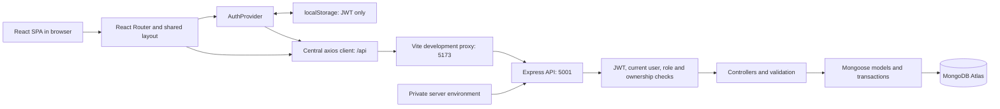
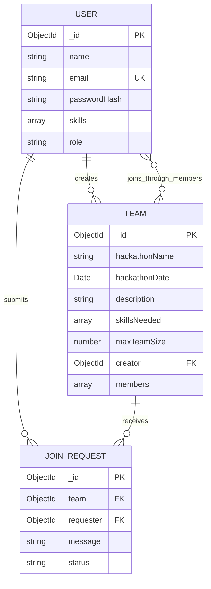
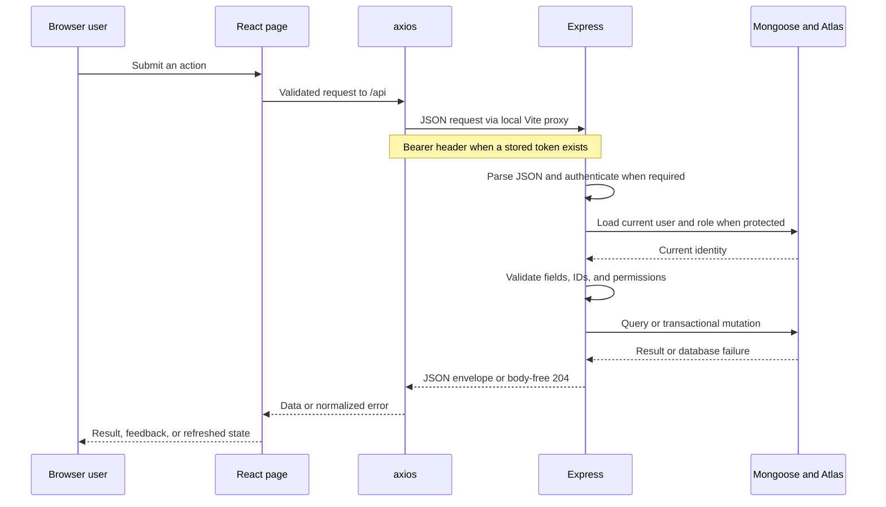
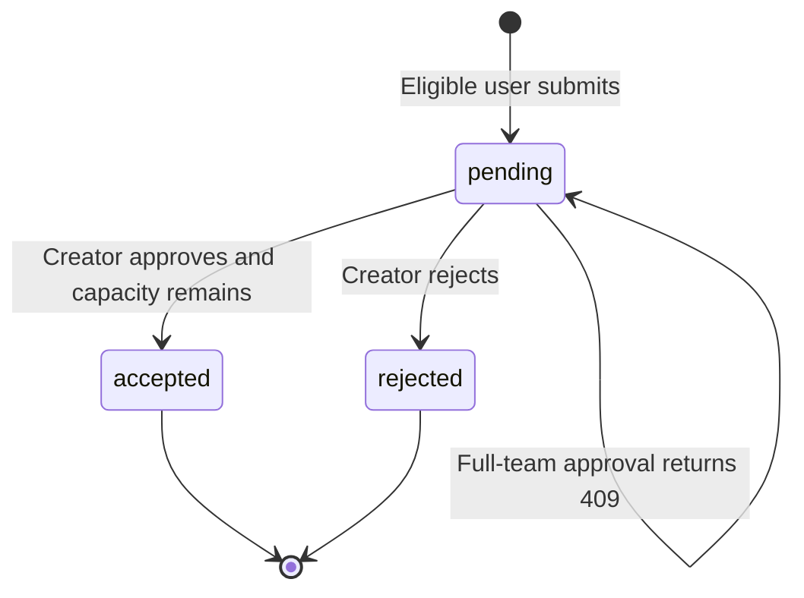

# System Architecture

## 1. Overview

Hackathon Team Finder is a three-tier MERN application: a React browser interface, an Express JSON API, and MongoDB Atlas accessed through Mongoose. There is no direct browser-to-database connection.



Vite is the **development** intermediary shown here. Local setup is documented in the [README](../README.md#local-setup); deployment is outside this submission's scope.

## 2. Code organization

| Location | Responsibility |
| --- | --- |
| `client/src/main.jsx`, `App.jsx` | React startup, BrowserRouter, auth provider, and page routes. |
| `client/src/components/` | Shared layout, route guards, forms, cards, states, and deletion modal. |
| `client/src/pages/` | Public discovery, authentication, personal workspaces, team ownership tools, and moderation. |
| `client/src/context/` | Current user/token, session restoration, login/register/logout. |
| `client/src/services/` | axios configuration, safe return destinations, team form validation, and date/reference helpers. |
| `client/src/hooks/useApiResource.js` | Read requests with loading/error/retry state and cancellation of stale requests. |
| `server/index.js` | Configuration loading, middleware, route mounts, errors, and startup sequencing. |
| `server/config/hackathonDB.js` | Atlas connection, existing DNS workaround, and redacted connection diagnostics. |
| `server/routes/` | HTTP paths, auth/role middleware, ID validation, and controller wiring. |
| `server/controllers/` | Business validation, ownership checks, persistence, and response shapes. |
| `server/models/` | User, Team, and JoinRequest schemas/indexes. |
| `server/middleware/` | Bearer authentication/current-user lookup and admin role enforcement. |
| `client/tests/`, `server/tests/` | Node-based regression suites. |

## 3. React frontend

The UI uses JavaScript modules, React Router, axios, and plain CSS. `Layout` provides branding, role-aware navigation, a skip link, a main content region, session-restoration feedback, and a footer.

### Page access

| Access | React paths |
| --- | --- |
| Public | `/`, `/teams`, `/teams/:id` |
| Guest forms | `/login`, `/register`; authenticated visitors are redirected to a recognized intended destination or Dashboard. |
| Authenticated | `/dashboard`, `/teams/new`, `/my-teams`, `/my-requests` |
| Authenticated, creator controls | `/teams/:id/edit`, `/teams/:id/manage`; loaded team ownership determines whether controls are rendered. |
| Authenticated admin | `/admin`, nested under both protected and admin guards. |
| Fallback | Unknown React paths render NotFound. |

Frontend guards improve navigation; backend authorization is the authority. The static `/teams/new` route is resolved as a creation page rather than a team ID.

Search/filter/page values are represented in the Browse Teams URL. Team cards link to details and carry the browse query for a return link. Join forms check `/api/requests/mine` so repeat visits can show an existing Pending/Accepted/Rejected request instead of creating another one.

`useApiResource` associates results with the URL, user scope, and retry attempt. It aborts obsolete reads and avoids displaying another request's stale results. Mutation forms use disabled buttons and an immediate busy lock to prevent duplicate clicks.

## 4. Express API and configuration

The backend uses CommonJS. `server/index.js` exports the Express app without listening on import. Direct local execution loads `server/.env`, awaits the initial database connection, and then listens on port 5001 by default. The thin root `api/handler.js` export imports this app for the prepared Vercel Node Function.

Mounted API families are `/api/auth`, `/api/teams`, `/api/requests`, and `/api/admin`, with `/api/health` directly on the application. See the [API Reference](API_REFERENCE.md) for the complete contract.

Private `MONGO_URI` and `JWT_SECRET` are server-side configuration. `PORT` defaults to 5001 for the local listener. The existing macOS/Atlas DNS workaround uses Node's DNS module with `8.8.8.8`. A module-scoped MongoDB promise shares initialization across concurrent/warm function requests, resets after an initial failure, and uses a driver pool capped at 10 per instance. Initialization gates database-dependent routers and returns controlled JSON 503 on failure; the helper never exits a function process. Direct local startup still exits unsuccessfully when it cannot initialize MongoDB. Connection diagnostics are redacted.

Prepared deployment uses one Vercel project at the repository root: static `client/dist/` output, a shared `/api/*` function rewrite, and an API/asset-excluding React deep-link fallback. APIs are not cached, deployed CORS is same-origin, and unknown API paths return JSON 404. Local Vite proxy behavior is unchanged. Deployment is **PREPARED, not cloud-verified**; see the [README settings](../README.md#vercel-deployment-preparation).

Handled parser/controller errors use JSON messages; unexpected controller/database failures are converted to a generic 500 response. Stack traces and credentials are not returned to clients.

## 5. MongoDB and Mongoose models

All three schemas use `{ timestamps: true }`, providing `createdAt` and `updatedAt`. Mongoose supplies `_id` and may supply version metadata. IDs/dates serialize to strings in JSON.

### User

| Field | Definition |
| --- | --- |
| `name` | Required trimmed string. |
| `email` | Required unique, lowercase, trimmed string. |
| `passwordHash` | Required string; excluded from normal query selection. |
| `skills` | String array, default `[]`. |
| `role` | `user` or `admin`, default `user`. |

Password hashing and password-length validation are controller responsibilities. Login explicitly selects the hash only for comparison; response construction still excludes it.

### Team

| Field | Definition |
| --- | --- |
| `hackathonName` | Required trimmed string. |
| `hackathonDate` | Required Date. Future/calendar validation is applied by controllers. |
| `description` | Required trimmed string. |
| `skillsNeeded` | String array, default `[]`. |
| `maxTeamSize` | Required number, schema minimum 2; controllers enforce a safe integer. |
| `creator` | Required User ObjectId reference. |
| `members` | User ObjectId reference array, default `[]` in the schema. Creation explicitly inserts the creator. |

### JoinRequest

| Field | Definition |
| --- | --- |
| `team` | Required Team ObjectId reference. |
| `requester` | Required User ObjectId reference. |
| `message` | Optional string, maximum length 300. |
| `status` | `pending`, `accepted`, or `rejected`, default `pending`. |

A unique compound index on `{ team: 1, requester: 1 }` prevents multiple requests for the same pair, regardless of their status. References are application relationships, not automatic MongoDB foreign-key cascades; controllers explicitly remove associated requests when deleting a team.



The `(team, requester)` pair is unique. One user may create several teams, belong to several teams, and submit requests to different teams.

## 6. JWT authentication and authorization

1. Registration validates input, hashes the password with bcrypt using 10 salt rounds, and creates role `user` regardless of the submitted role.
2. Registration/login signs an HS256 JWT using `JWT_SECRET`. Application claims are `id` and `role`; `iat` and `exp` are standard timing claims. Expiry is seven days.
3. The React auth provider stores the token in localStorage and keeps the user in memory. It does not persist passwords.
4. axios attaches the token as a Bearer authorization header. On load, AuthProvider requests `/api/auth/me` before treating a stored session as restored.
5. Authentication middleware verifies the signature/expiry and ID, then reloads the current user and role from MongoDB into `req.user`.
6. Creator operations compare the current user ID with `Team.creator`. Admin middleware checks the database-derived `req.user.role`, not the token's possibly stale role claim.
7. Applicable protected-request 401 responses clear matching local credentials. A failed login does not clear an existing session; a stale failure cannot clear a newer token. Network/server failures during restoration retain credentials for retry.

Logout clears the browser token and in-memory user. There is no logout/revocation or refresh-token API. Role revocation takes effect on the next authenticated backend request, even with an older admin-claim JWT; the browser navigation updates after profile restoration/relogin.

## 7. API request lifecycle



Public browse/detail requests omit the protected identity lookup. In the frontend, a user's own profile uses `id`, while Mongoose documents/public references use `_id`; components handle the actual response variants rather than assuming all references have one shape.

## 8. Join-request consistency and concurrency

### Submission

Submission validates team existence, non-membership/non-ownership, available capacity, and absence of any prior request. Inside a transaction it increments the team's version field before creating the pending request. This write serializes submission with team changes/deletion; the unique compound index is the final duplicate guard. No membership is added during submission.

### Decisions



Accepted/rejected requests have no further decision transition or resubmission path. Deleting a team removes its request documents separately from these status transitions.

```mermaid
sequenceDiagram
    participant C as Team creator
    participant E as Express controller
    participant D as MongoDB transaction
    C->>E: PATCH request with accepted status
    E->>D: Read team and matching pending request
    E->>E: Check creator ownership and prevent self-decision
    E->>D: Conditional addToSet to members
    Note over E,D: Requester absent AND size(members) less than maxTeamSize
    alt Full team or requester already a member
        E->>D: Abort transaction
        E-->>C: 409; request remains pending
    else Capacity available
        E->>D: Change request from pending to accepted
        E->>D: Commit both writes
        E-->>C: 200 with updated request
    end
```

The capacity condition is evaluated in the database with `$expr`/`$size`, not just in the UI. `$addToSet` avoids duplicate member IDs. The request update also requires `status: pending`. If any step fails, the transaction aborts, so membership cannot commit without the corresponding acceptance.

`withTransaction` allows the MongoDB driver to retry transient transaction conflicts. When two approvals compete for the final slot, one can commit; the other retry observes the updated state and returns 409 rather than overfilling. Approvals for other teams do not remove existing memberships. Rejection changes request status only, leaving the team unchanged.

### Edits and deletion

Capacity reductions use a database predicate requiring the current member count to fit the proposed maximum. Creator and admin deletion controllers use transactions to delete matching JoinRequest documents and the team together. There is no automatic permanent request-history archive after deletion.

See [Testing](TESTING.md) for verified race/cascade checks and the remaining browser-testing boundary.

## 9. Design choices relative to the supplied ICTAK guide

The guide permits a consistent structure that differs from its sample (§4, bundle page 5). This project keeps routes/controllers/models directly under `server/` with `index.js` as its entry point, rather than adding a `server/src/` layer. This preserves the working project's organization.

One axios instance centralizes the base URL, headers, and error handling. Individual endpoint calls remain in page/form components and the shared fetch hook, rather than all being exported from service-function modules. This is a partial difference from §4/§7.2's API-service separation guidance; no refactoring is claimed.

The client intentionally uses relative `/api` with the existing local Vite proxy and prepared same-origin Vercel rewrites. It does **not** read `VITE_API_URL` or require a client environment file. This avoids exposing backend configuration to the client while differing from the guide's environment-based URL example. The actual server variable is `MONGO_URI`, and its local port is **5001**; the guide's example variable/port names are illustrative, not replacements for this application's contract.

The prepared deployment disables cross-origin CORS permission; direct local browser access is limited to the Vite origin. Rate limiting and pagination for personal/admin lists are not implemented. These remain documented gaps rather than completed security/scale controls. See [Submission Alignment](SUBMISSION_ALIGNMENT.md) for references and evidence status.

No original wireframes were supplied. The architecture, route table, and demo navigation describe the implemented structure; they are not represented as dated design-stage wireframes or as screenshots of verified mobile layouts.
